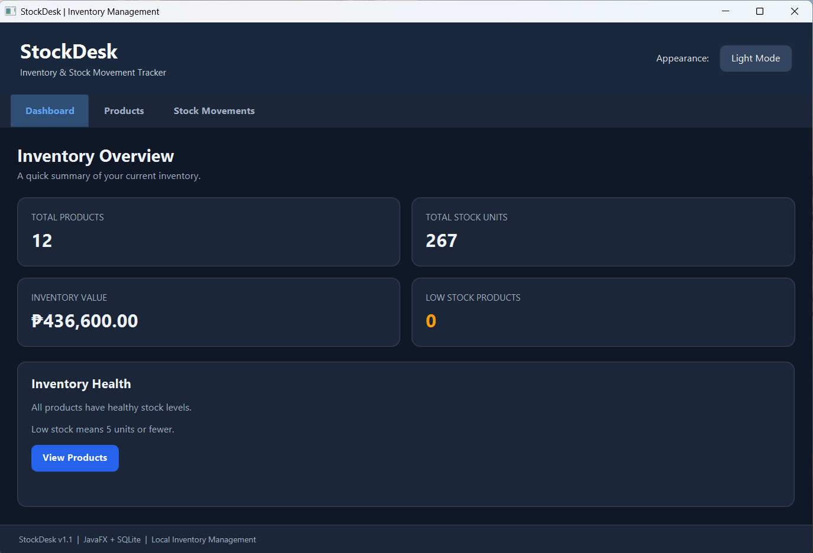
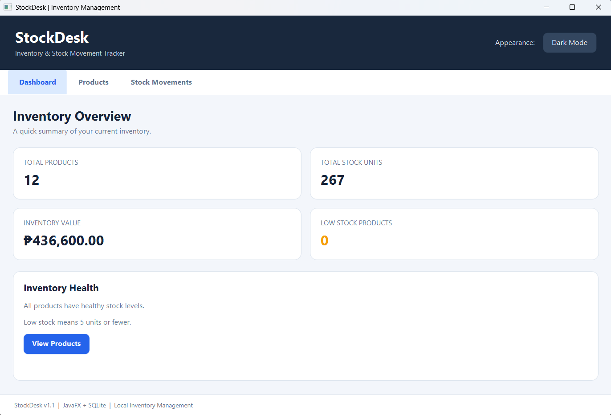
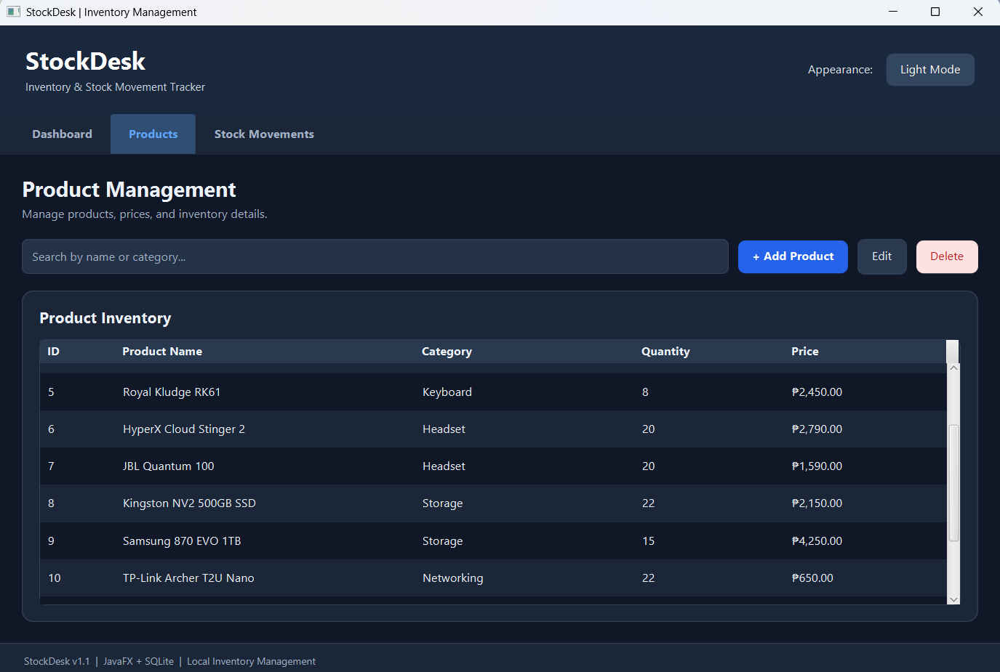
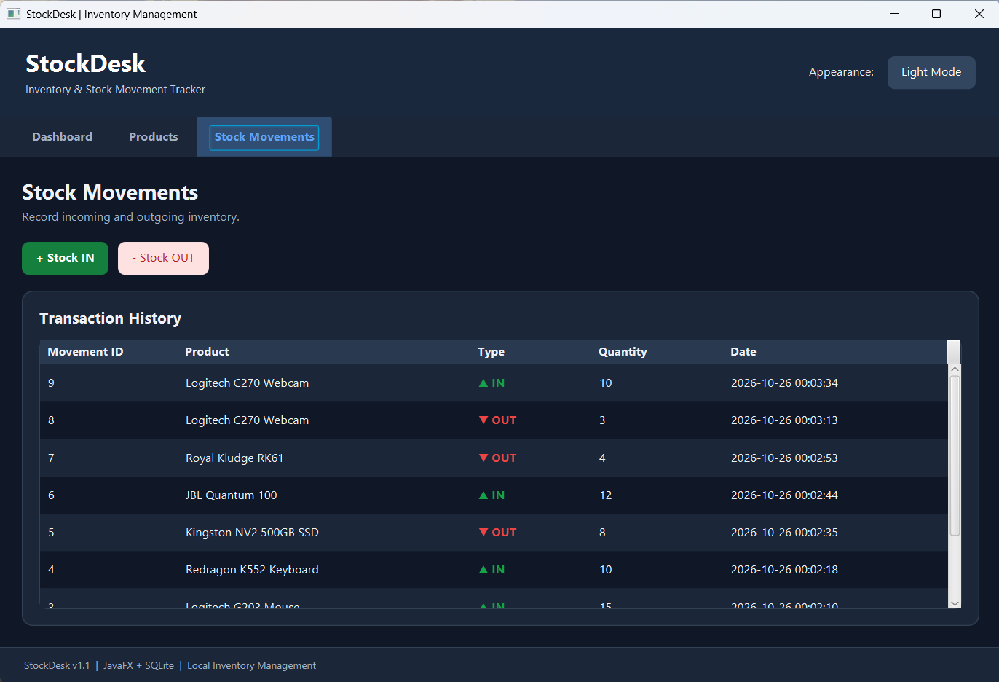

# 📦 StockDesk

### Desktop Inventory & Stock Movement Tracker

A modern JavaFX desktop application designed to manage products, track stock movements, and monitor inventory levels with persistent local storage.

**Built with Java 21, JavaFX, SQLite, JDBC, and Maven.**


---

## 🖥️ Application Preview

### Dark Mode Dashboard



### Light Mode Dashboard



### Product Management



### Stock Movement History



---

## ✨ Features

**Product Management**
- Add, edit, delete, and search products
- Manage product categories, quantities, and prices
- Validate product information

**Stock Movement Tracking**
- Record Stock IN and Stock OUT
- Prevent insufficient-stock transactions
- Maintain stock movement history

**Inventory Dashboard**
- Total products
- Total stock units
- Total inventory value
- Low-stock monitoring

**Modern Interface**
- Switchable light and dark themes
- Saved theme preferences
- Styled forms and validation dialogs

**SQLite Database**
- Persistent local storage
- JDBC database connectivity
- No external database server required

---

## 🛠️ Tech Stack

| Technology | Purpose |
|---|---|
| Java 21 | Application logic |
| JavaFX | Desktop user interface |
| FXML | UI layout |
| CSS | Styling and themes |
| SQLite | Local database |
| JDBC | Database connectivity |
| Maven | Project build and dependencies |

---

## 🏗️ Architecture

The application uses a simple layered structure:

```text
JavaFX Interface (FXML + CSS)
            |
            v
     HelloController
            |
            v
    StockDeskRepository
            |
            v
     DatabaseManager
            |
            v
      SQLite Database
```

---

## 🚀 Getting Started

### Requirements

- Java Development Kit (JDK) 21
- Maven
- IntelliJ IDEA (recommended)

### Installation

Clone the repository:

```bash
git clone https://github.com/YOUR_USERNAME/StockDesk.git
```

Navigate to the project:

```bash
cd StockDesk
```

Run using Maven:

```bash
mvn clean javafx:run
```

Alternatively, import the Maven project into IntelliJ IDEA and run the JavaFX application using the configured JDK.

### Database

StockDesk uses a local SQLite database file.

No separate database server is required. The application initializes its database automatically.

---

## 📈 Future Improvements

- Export inventory reports to CSV
- Customizable low-stock thresholds
- Additional inventory filters
- Desktop executable packaging
- Automated unit tests

---

## 👨‍💻 About

StockDesk is a personal Java desktop development project created to practice JavaFX, SQL, JDBC, and inventory management concepts.

It demonstrates desktop UI development, local database persistence, and basic inventory operations.

---

**StockDesk — Built with JavaFX and SQLite.**